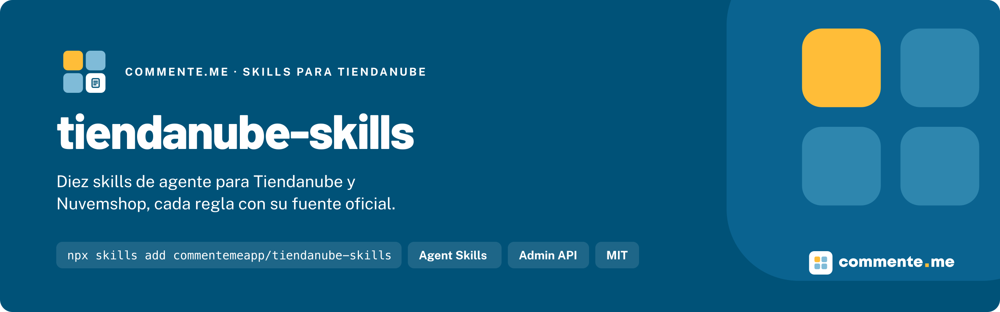

<p align="center">
  
</p>

# tiendanube-skills

**Diez skills de agente para desarrollar apps e integraciones en Tiendanube y Nuvemshop, cada regla con su fuente oficial.**


## Instalación

```bash
npx skills add commentemeapp/tiendanube-skills
```

Con el CLI de GitHub, `gh skill install commentemeapp/tiendanube-skills`. `--scope user` las deja disponibles en todos los proyectos.

## Uso rápido

Instaladas, el agente las carga solo cuando la tarea las pide. Por ejemplo, "registra el webhook `order/paid` y verifica la firma" activa `tiendanube-webhooks`, y "sincroniza el stock por location desde el ERP" activa `tiendanube-erp-integration`. Para forzar una, nómbrala en el pedido.

## Que incluye

Para apps de partners e integraciones propias: la Admin API, OAuth, webhooks, catálogo, pedidos, apps de envío y de pago, NubeSDK, apps del Admin, temas e integración con ERP.

| Skill                                                                                  | Cuándo se usa                                                                                                 | Fuentes |
| -------------------------------------------------------------------------------------- | ------------------------------------------------------------------------------------------------------------- | ------- |
| [`tiendanube-rest-api`](skills/tiendanube-rest-api/SKILL.md)                           | La base de toda llamada: URL con versión y `store_id`, headers, errores, rate limit y paginación.             | 11      |
| [`tiendanube-oauth-apps`](skills/tiendanube-oauth-apps/SKILL.md)                       | El app en el Partners Portal, el flujo authorization code, scopes y el token por tienda.                      | 9       |
| [`tiendanube-webhooks`](skills/tiendanube-webhooks/SKILL.md)                           | Eventos, registro, firma HMAC, reintentos y los webhooks obligatorios de privacidad.                          | 8       |
| [`tiendanube-catalog`](skills/tiendanube-catalog/SKILL.md)                             | Productos, variantes, imágenes, categorías, stock por location, kits, tablas de precio y custom fields.       | 19      |
| [`tiendanube-orders-fulfillment`](skills/tiendanube-orders-fulfillment/SKILL.md)       | Pedidos y sus estados, fulfillment orders, draft orders, transacciones, disputas, facturas y etiquetas.       | 17      |
| [`tiendanube-shipping-payment-apps`](skills/tiendanube-shipping-payment-apps/SKILL.md) | Apps de envío (carriers y callback de cotización) y de pago (payment providers, opciones y transacciones).    | 11      |
| [`tiendanube-nube-sdk`](skills/tiendanube-nube-sdk/SKILL.md)                           | Código en el storefront y el checkout con NubeSDK: slots, componentes, eventos, state y migración de scripts. | 26      |
| [`tiendanube-admin-apps`](skills/tiendanube-admin-apps/SKILL.md)                       | Apps dentro del Admin con Nexo y Nimbus, apps externos, templates, homologación, publicación y Billing.       | 30      |
| [`tiendanube-themes`](skills/tiendanube-themes/SKILL.md)                               | Temas seccionables (Ipanema) y clásicos, Twig y el CLI, como complemento de las skills oficiales del CLI.     | 30      |
| [`tiendanube-erp-integration`](skills/tiendanube-erp-integration/SKILL.md)             | Conectar ERP, OMS o WMS y migrar catálogo y clientes desde otra plataforma.                                   | 19      |

La columna Fuentes cuenta las páginas y archivos que cita la sección Reference de cada skill. Las skills siguen el formato Agent Skills (`skills/<nombre>/SKILL.md`) y la misma estructura que [adobe-commerce-skills](https://github.com/commentemeapp/adobe-commerce-skills): cuándo aplica y cuándo no, reglas de decisión, restricciones con el porque, como detectarlas y un ejemplo correcto y uno incorrecto, el patrón recomendado, los errores comunes, una lista de revisión y la referencia. Están en inglés, como la documentación de donde salen. Código abierto y sin costo.

## Por que existe

Tiendanube publica su documentación lista para agentes, un [Admin MCP](https://nuvemshop.dev/en-US/ai-agents/admin-mcp.md) para operar la tienda conversando y las [Agent Skills del CLI](https://nuvemshop.dev/en-US/themes/developer-tools/cli/agent-skills.md) para editar temas. Nada cubría el código de quien construye sobre la plataforma: el flujo OAuth, la firma de los webhooks, el stock por location, los fulfillment orders, las apps de envío y de pago, NubeSDK o la sincronización con un ERP. Este repositorio llena ese hueco y no repite lo oficial: para operar una tienda, ocupa el Admin MCP; para editar un tema, las skills del CLI, que `tiendanube-themes` complementa.

## Documentación

### En cada agente

Las skills siguen el estándar abierto [Agent Skills](https://agentskills.io): el mismo `SKILL.md` sirve en Claude Code, Codex, Cursor, GitHub Copilot y Gemini CLI. `npx skills add` detecta los agentes instalados; con `-a` eliges a cuales va:

```bash
npx skills add commentemeapp/tiendanube-skills -a claude-code -a codex -a cursor -a github-copilot -a gemini-cli
```

| Agente         | `-a`             | En el proyecto    | Para todos los proyectos (`-g`) |
| -------------- | ---------------- | ----------------- | ------------------------------- |
| Claude Code    | `claude-code`    | `.claude/skills/` | `~/.claude/skills/`             |
| Codex          | `codex`          | `.agents/skills/` | `~/.agents/skills/`             |
| Cursor         | `cursor`         | `.agents/skills/` | `~/.cursor/skills/`             |
| GitHub Copilot | `github-copilot` | `.agents/skills/` | `~/.copilot/skills/`            |
| Gemini CLI     | `gemini-cli`     | `.agents/skills/` | `~/.gemini/skills/`             |

Las rutas son las del [CLI `skills`](https://github.com/vercel-labs/skills/blob/main/docs/agents.md). En todos los agentes la skill entra cuando la tarea coincide con su `description`; para forzar una, nómbrala en el pedido.

### Por que no es un plugin de Claude Code

A propósito: instaladas como plugin, las skills ganan el nombre del plugin adelante, y los agentes que las precargan por nombre dejan de encontrarlas.

### De dónde vienen las reglas

- **La documentación oficial de [nuvemshop.dev](https://nuvemshop.dev/en-US/llms.txt)**, consultada el 05-11-2026. No tiene licencia abierta: las skills la resumen con palabras propias y citan cada página por la URL de su versión Markdown. No se copia texto de ella.
- **Seis repositorios MIT de [TiendaNube](https://github.com/TiendaNube)**: `nube-sdk`, los cuatro templates de app y `nimbus-design-system`, cada uno fijado en un commit en [data/fonte.json](data/fonte.json).

Las reglas:

- **Lo que la documentación no dice, la skill no lo afirma.** Las pocas recomendaciones propias, como quién es dueño de cada dato en una integración con ERP, están marcadas como tales.
- **Cada skill cita sus fuentes.** La sección Reference de cada `SKILL.md` lista cada página o archivo con su enlace.
- **Las contradicciones de la documentación** están en [docs/divergencias.md](docs/divergencias.md), con lo que hace la skill en cada caso. Cuando la documentación cambie, se revisa esa lista primero.

Las atribuciones están en [NOTICE](NOTICE).

### Desarrollo

Pide Node `>= 20`.

```bash
git clone https://github.com/commentemeapp/tiendanube-skills.git
cd tiendanube-skills
npm ci
npm run verificar
```

`scripts/verificar.sh` es el gate, el mismo que corre el CI: JSON válido; el frontmatter de cada skill (`name` igual a la carpeta, kebab-case, prefijo `tiendanube-`, `description` de hasta 1024 caracteres que empieza por "Apply when", `license` y `compatibility`); las siete secciones; una sección Reference con al menos una fuente; que **cada página citada responda 200** y que **cada archivo citado exista en el commit fijado**; Prettier; `bash -n`, y una búsqueda de rastros (rutas de una máquina, correos personales, nombres de clientes, portugués). Lo que no responde se informa como "no verificado", nunca como verde (en el CI, es una falla).

Una regla nueva necesita su página en la documentación oficial: lee la página, escribe la regla y cita la página en Reference. Los cambios de cada versión están en [CHANGELOG.md](CHANGELOG.md).

## Contribuir · Licencia

Abre un PR contra `dev` con Conventional Commits; la promoción a `main` es merge de la rama entera `dev`.

[MIT](LICENSE). Las fuentes y sus licencias, en [NOTICE](NOTICE).

---

Hecho por [commente.me](https://www.commente.me) · hablecon@commente.me
